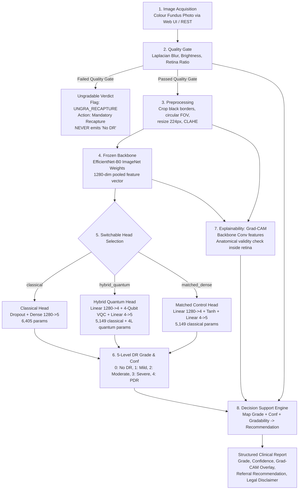

# Q-RetinaScreen: Intelligent Healthcare System for Early Diagnosis of Diabetic Retinopathy Using AI and Quantum-Enhanced Deep Learning

> **REGULATORY DISCLAIMER**:  
> **SCREENING RECOMMENDATION AID ONLY, NOT A DIAGNOSTIC DEVICE.**  
> This system is designed strictly to assist qualified healthcare professionals in tele-ophthalmology screening, clinical triage, and referral prioritization. It does not replace a clinical examination by an ophthalmologist or optometrist. All images are processed locally; no patient data or images ever leave the local machine.

---

## 1. System Pipeline Architecture

The end-to-end clinical workflow strictly follows this sequential pipeline:



---

## 2. Mathematical Formulation & Exact Parameter Counts

### A. Hybrid Quantum Head (`PennyLane`, `default.qubit` exact simulator)
1. **Classical Dimension Reduction Layer**:
   $$\mathbf{v} = \frac{\pi}{2} \tanh(W_1 \mathbf{f} + \mathbf{b}_1)$$
   - Input $\mathbf{f} \in \mathbb{R}^{1280}$ (frozen EfficientNet-B0 pooled feature vector).
   - $W_1 \in \mathbb{R}^{4 \times 1280}$, $\mathbf{b}_1 \in \mathbb{R}^4 \implies 4 \times 1280 + 4 =$ **$5,124$ classical parameters**.
   - Bounded in $[-\pi/2, \pi/2]$ to prevent angle saturation.

2. **4-Qubit Variational Quantum Circuit (VQC)**:
   - Initial state: $|0\rangle^{\otimes 4}$.
   - State preparation: Hadamard $H^{\otimes 4}$ followed by angle embedding $R_Y(v_k)$ on qubit $k \in \{0, 1, 2, 3\}$.
   - $L$ variational layers ($L \in \{2, 3, 4\}$, default $L=3$):
     - Circular CNOT chain: $\text{CNOT}(0, 1), \text{CNOT}(1, 2), \text{CNOT}(2, 3), \text{CNOT}(3, 0)$.
     - Trainable rotation block: $R_Y(w_{l, k})$ on each qubit $k$ in layer $l$.
   - **Quantum Parameters**: $4 \times L$ trainable weights (**$12$ parameters** for $L=3$).
   - Gradients: Parameter-shift rule for circuit angles; backpropagation for classical layers.
   - Readout: Pauli-$Z$ expectation measurements:
     $$z_k = \langle \psi(\mathbf{v}, \mathbf{w}) | Z_k | \psi(\mathbf{v}, \mathbf{w}) \rangle \in [-1, 1], \quad k \in \{0, 1, 2, 3\}$$

3. **Classical Classification Readout Layer**:
   $$\hat{\mathbf{y}} = \text{softmax}(W_2 \mathbf{z} + \mathbf{b}_2)$$
   - $W_2 \in \mathbb{R}^{5 \times 4}$, $\mathbf{b}_2 \in \mathbb{R}^5 \implies 5 \times 4 + 5 =$ **$25$ classical parameters**.
   - **Total Classical Parameters**: $5,124 + 25 = 5,149$.
   - **Total Quantum Parameters**: $4L$ ($12$ for $L=3$).
   - **Grand Total**: $5,161$ parameters.

### B. Matched Control Head (Mandatory Ablation)
To isolate quantum circuit expressivity without confounding dimensional bottlenecks:
- Linear $1280 \to 4$ ($5,124$ params) $\to \tanh(\cdot)$ (matching the $[-1, 1]$ Pauli-$Z$ range) $\to$ Linear $4 \to 5$ ($25$ params).
- **Total Parameters**: Exactly **$5,149$ parameters** (zero architectural confounders).

### C. Classical Direct Head
- Dropout ($p=0.2$) $\to$ Linear $1280 \to 5$ ($1280 \times 5 + 5 =$ **$6,405$ parameters**).

---

## 3. Strict Clinical Safety & Evaluation Rules

1. **Ungradable Invariant**: Any fundus photograph failing the Quality Gate (blur, under/over-exposure, or retinal circle $< 55\%$ of expected area) is flagged as `UNGRA_RECAPTURE`. An ungradable image **never** proceeds to classification and **never** emits a false-reassuring "No DR".
2. **Patient-Disjoint Splitting**: Images from the same patient are strictly isolated in a single partition (Train, Val, or Test). Zero patient leakage.
3. **Training-Only Oversampling**: Minority class rebalancing is executed **only on the training split**, strictly after the train/val/test split is locked.
4. **Validation-Only Calibration & Thresholds**: Probability calibration (temperature scaling) and referable DR decision thresholds (targeting $\ge 85-90\%$ sensitivity) are tuned **exclusively on the validation split** before evaluating the locked test set.
5. **No Benefit Presumption & Honest Reporting**: Paired non-parametric Wilcoxon signed-rank tests are computed across $\ge 5$ random seeds. If the quantum circuit yields no statistically significant advantage over the matched classical control, this is explicitly and honestly reported.

---

## 4. Setup and Quick Start

### A. Environment Installation
Requires Python 3.10+ on Windows, Linux, or macOS:
```bash
pip install -r requirements.txt
```

### B. Generate Demo Dataset & Manifests
Generates a deterministic synthetic fundus dataset (with realistic vascular trees, optic discs, lesions, and deliberate ungradable artefacts) for immediate out-of-the-box execution:
```bash
python data/prepare_datasets.py --demo
```

### C. Pre-compute and Cache Backbone Features
Extracts and caches 1280-d frozen EfficientNet-B0 embeddings to disk for instant multi-seed training:
```bash
python -m src.models.extract_features --manifest data/manifests/demo_manifest.csv
python -m src.models.extract_features --manifest data/manifests/external_test.csv
```

### D. Train a Screening Model
```bash
# Train Hybrid Quantum Head (PennyLane 4-Qubit VQC)
python train.py --head hybrid_quantum --seed 42 --epochs 15

# Train Matched Dense Control Head
python train.py --head matched_dense --seed 42 --epochs 15

# Train Classical Head
python train.py --head classical --seed 42 --epochs 15
```

### E. Run Full 5-Seed Quantum Ablation Benchmark
Trains all 3 heads across 5 disjoint seeds (`[42, 43, 44, 45, 46]`), computes mean $\pm$ std metrics, and executes paired Wilcoxon signed-rank tests:
```bash
python ablation.py --seeds 42 43 44 45 46 --fast
```
*Outputs generated in `reports/quantum_ablation_report.md` and `reports/quantum_ablation_summary.json`.*

### F. Locked Single-Pass Test Evaluation
```bash
python evaluate.py --checkpoint checkpoints/ablation/checkpoint_hybrid_quantum_seed42.pt --split test
```

### G. Launch Flask Web Application
```bash
python app/app.py
```
Open [http://localhost:5000](http://localhost:5000) in your browser:
- **Clinician Login:** `clinician` / `doctor123` (Full triage, Grad-CAM inspection)
- **Technician Login:** `technician` / `tech123` (Acquisition & imageability check)
- **Administrator Login:** `admin` / `admin123` (Audits & settings)

---

## 5. Automated Test Suite

Run the complete pytest verification suite:
```bash
pytest tests/ -v
```
Verifies:
- `test_preprocessing.py`: Border cropping, circular FOV, CLAHE stability, output shape `(3, 224, 224)`.
- `test_quality_gate.py`: Rejection of blur, dark, bright, and clipped images; safety invariant enforcement.
- `test_models.py`: Exact parameter counts (5,124 + 25 classical, 4L quantum), gradient flow, head switching.
- `test_splits.py`: Patient-disjoint isolation, zero leakage across train/val/test, oversampling isolation.
- `test_decision.py`: Grade-to-urgency mappings, human review triggers, disclaimer presence.
- `test_backbone.py`: Frozen parameter verification, pooled feature dimensions.
- `test_app.py`: Role-based authentication, `/predict` API, and AES-GCM encrypted storage at rest.

---

## 6. Docker Container Deployment

Build and launch the reproducible container:
```bash
docker build -t q-retinascreen .
docker run -p 5000:5000 q-retinascreen
```

---

## 7. Limitations & Clinical Governance

1. **Screening Support Only**: This system does not replace direct clinical examination by a certified eye care provider.
2. **Backbone Saliency**: Grad-CAM visualizes convolutional activations in the classical EfficientNet-B0 backbone. It highlights salient retinal texture, not microscopic lesion contours or quantum circuit states.
3. **Quantum Simulator Execution**: PennyLane runs locally on the CPU exact statevector simulator `default.qubit`. No physical quantum hardware or cloud tokens are required.
"# dr-finalyear" 
